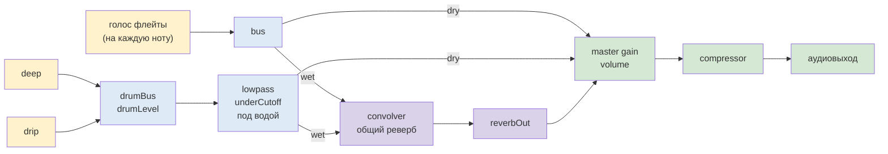
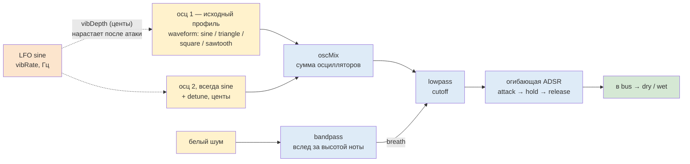
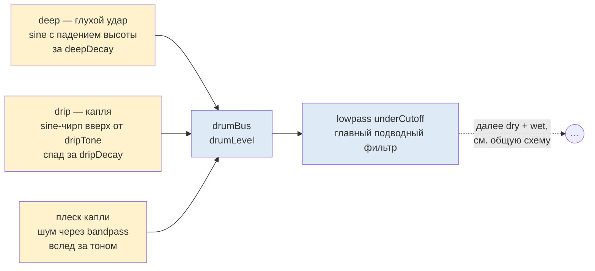

# Prismatica — Electronic web Synth

Прототип веб-синтезатора на чистом Web Audio API (без библиотек): электронная флейта + драм-партия «подводная пещера», два piano-roll по 16 шагов, минималистичный CSS.

**Файлы:** `index.html` — разметка · `style.css` — временные стили · `app.js` — вся логика. Подробные PlantUML-диаграммы: `docs/puml` (исходники) и `docs/img` (картинки).

---

## Использование моелей ИИ при работе с проектом

В работе над проектом я использовала ChatGPT (OpenAI) через веб-интерфейс, без подключения к среде разработки. Ассистент предлагал код, а я вручную переносила его в файлы проекта. Запуск, проверку в браузере и все операции с git я выполняла самостоятельно. У ИИ не было доступа к файлам и репозиторию: я передавала ему нужные фрагменты кода и описывала результаты изменений.

Как строилась работа с ИИ

Прототип создавался постепенно, через короткие запросы и уточнения. Я определяла задачи и оценивала результат, а ассистент помогал с реализацией.

- Разбор работы синтезатора. Прежде чем переходить к реализации, я долго разбиралась с помощью ИИ в том, как вообще работает синтезатор: что означают треугольная и прямоугольная формы волны у источника звука, чем они отличаются, что такое фильтры и как разные параметры влияют на звучание. Я задавала уточняющие вопросы и просила объяснять сложные вещи простыми словами. Это помогло мне лучше понять устройство синтезатора и осознаннее подходить к работе над прототипом.
- Работа по этапам. Сначала мы работали над прототипом флейты и сетки, затем добавили драм-партию, после этого перешли к рефакторингу кода и уточнению работы параметров.
- Поиск ошибок. Если что-то не работало, я описывала проблему ассистенту. Затем мы разбирали возможные причины: кэш браузера, неверный путь к файлу или необходимость дополнительной проверки, в том числе в headless-режиме.

### Что я делала самостоятельно

За мной оставались все содержательные решения: характер звука, диапазон нот, набор и группировка параметров, функциональность прототипа и объём диаграмм. Я проверяла результат в браузере, тестировала звук на слух и формулировала замечания. Также самостоятельно компилировала диаграммы, работала с git и публиковала код.

Таким образом, ChatGPT помогал мне писать и дорабатывать код под заданные требования. При этом решения о том, как должен работать прототип, и проверка результата оставались за мной.

---

## Общий поток сигнала

На этом уровне живут параметры: `wet` — общий реверб-сенд; `drumLevel`, `underCutoff` — драм-шина; `volume` — мастер.

Реверб один на всё: во вход convolver сходятся флейтовый сенд и барабанный, оба масштабируются одним параметром `wet` (общая панель).

---

## Голос флейты — порядок обработки волны

Этапы строго по ходу сигнала: источник → микс → фильтр → огибающая. Вибрато влияет **до** фильтра — на detune осцилляторов.

---

## Барабанные голоса — подводная пещера

Вайб пещеры = lowpass (глушит верха) + щедрый общий `wet`.

---

## Планировщик (реальная логика)

- 16 шагов на такт-луп, шаг = 16-я нота: `60 / bpm / 4`, bpm ограничен 80–110
- lookahead-планировщик: `setInterval` каждые 25 мс планирует ноты на 120 мс вперёд по `audioContext.currentTime` — тайминги не плывут
- нота играет чуть короче шага — пауза между нотами даёт артикуляцию флейты
- плейхед — подсветка колонки через `setTimeout`, синхронно на обеих сетках
- `volume`, `wet`, `underCutoff`, `drumLevel` применяются на лету; остальные — при следующей ноте

---

## Панели и параметры

Вёрстка — по макету «MacBook Air - 1» (1280×832): шапка с логотипом, панель MELODY, сцена с bpm-ручкой и двумя пиано-роллами, панель DRUMS. Крутилок-ручек три: `bpm` (циановая, в сцене) и две `detune` (фиолетовые, в панелях). Остальные параметры — слайдеры, `waveform` — степпер ◄ ►.

| Параметр | Где | Этап по ходу сигнала | Что делает |
|---|---|---|---|
| `volume` | центр, мастер-шкала | master gain перед компрессором | общая громкость |
| `bpm` | сцена (ручка) | планировщик | длительность шага = 60/bpm/4 (80–110) |
| `fluteLevel` | MELODY, volume | gain флейтового bus | громкость флейты |
| `detune` | MELODY (крутилка) | источник: осц 2 | статичная расстройка осц 2 (центы) — толщина звука |
| `waveform` | MELODY (степпер) | источник: осц 1 | профиль волны: sine / triangle / square / sawtooth |
| `cutoff` | MELODY | lowpass после oscMix | срез верхов — главный тембровый фильтр |
| `breath` | MELODY | вход lowpass-фильтра | громкость bandpass-шума «дыхания» |
| `vib depth` | MELODY | LFO → detune осц (до фильтра) | глубина вибрато, нарастает после атаки |
| `vib rate` | MELODY | LFO → detune осц | частота вибрато |
| `attack` | MELODY | огибающая после фильтра | время атаки (заодно задержка вибрато) |
| `release` | MELODY | огибающая после фильтра | время спада после гейта |
| `drumVolume` | DRUMS, volume | gain после lowpass драм-шины | громкость драмов |
| `detune all` | DRUMS (крутилка) | все источники: флейта + барабаны | глобальный сдвиг высоты в центах (−50…+50) |
| `underwater` | DRUMS | lowpass после drumBus | «подводное» приглушение |
| `drum level` | DRUMS | drumBus до фильтра | громкость драм-партии |
| `wet` | DRUMS | сенды bus и drum-lowpass в общий реверб | «мокрость» всего микса |
| `deep pitch` | DRUMS | источник deep | стартовая высота удара, падает к хвосту |
| `deep decay` | DRUMS | источник + огибающая deep | длина удара |
| `drip tone` | DRUMS | источник drip | частота чирпа капли |
| `drip decay` | DRUMS | огибающая drip | длина капли и её плеска |

Живое применение: `volume`, `fluteLevel`, `drumVolume`, `wet`, `underCutoff`, `drumLevel` меняются на лету; `detuneAll`, вибрато, огибающие и тоны барабанов — при следующей ноте/ударе.
